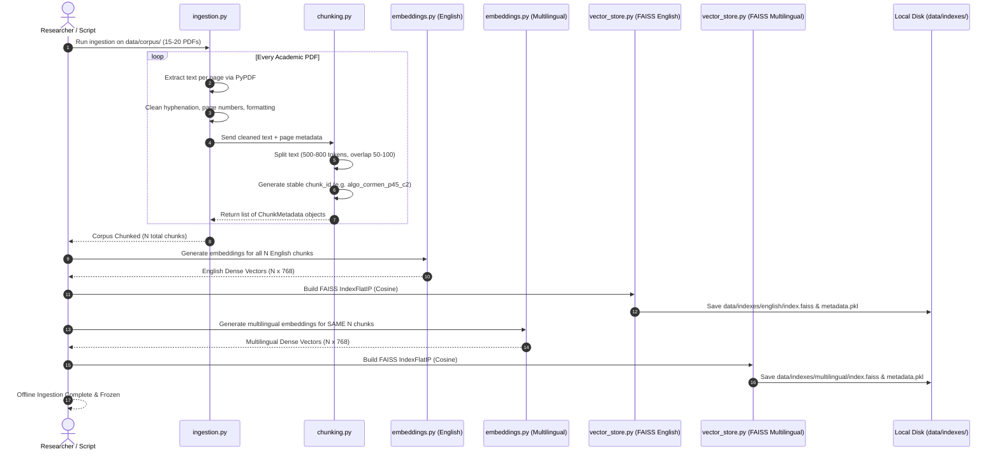
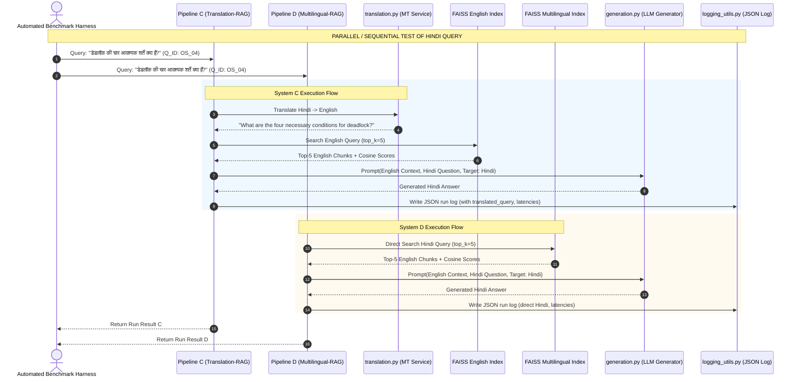
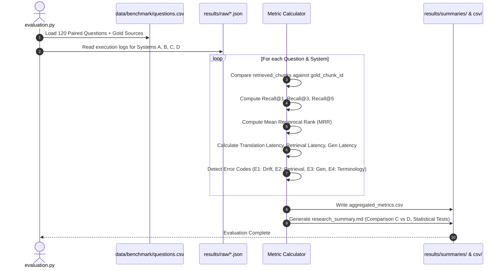

# English–Hindi Cross-Lingual Academic RAG Experimentation Platform
## Comprehensive Architecture, BID (Business & Implementation Design) Blueprint, and Operational Manual

---

### Executive Summary

In higher education, high-quality reference textbooks, syllabi, research papers, and technical documentations for core Computer Science domains (Algorithms, Automata Theory, Database Management Systems, Operating Systems, and Computer Networks) are overwhelmingly authored and indexed in **English**. However, hundreds of millions of students, engineers, and researchers conceptualize and query technical problems in **Hindi** (or mixed code-switched Hindi-English).

This project is a **scientific research experimentation platform** engineered to study, benchmark, and quantify the performance of cross-lingual Retrieval-Augmented Generation (RAG). 

#### Core Research Question
> **When an academic question is formulated in Hindi against an academic corpus authored in English, how does the linguistic bridging mechanism affect retrieval accuracy, answer correctness, semantic faithfulness, translation drift, and computational latency?**

The platform contrasts two primary bridging paradigms under strictly controlled, identical conditions:
1. **System C (Translation-Mediated RAG):** Translates the incoming Hindi query into English using a Machine Translation (MT) model, retrieves relevant English text using an English embedding model, and generates a Hindi response.
2. **System D (Direct Multilingual RAG):** Employs a cross-lingual dense embedding model that maps Hindi queries and English documents into a shared vector space, performing zero-shot retrieval without runtime query translation, followed by Hindi generation.

These are anchored against two baseline controls:
- **System A (Direct LLM Baseline):** Closed-book generation without retrieval (measures parametric memory and cross-lingual comprehension without external grounding).
- **System B (Monolingual English RAG Baseline):** Native English query retrieving from English corpus and generating English output (represents the retrieval upper bound).

---

## 1. Master System Architecture & Pipeline Topologies

The system enforces strict experimental controls across four distinct execution pipelines (A, B, C, D).

```
=================================================================================================
                                   SYSTEM ARCHITECTURE TOPOLOGY
=================================================================================================

    [Academic Corpus: 15-20 Core CS English PDFs]
                         │
                         ▼
        ┌──────────────────────────────────┐
        │   Page-Aware Document Chunking   │  (500-800 tokens, 50-100 token overlap)
        │   Stable ID: doc_p{page}_c{chunk}│
        └─────────────────┬────────────────┘
                          │
            ┌─────────────┴─────────────┐
            ▼                           ▼
  ┌───────────────────┐       ┌───────────────────┐
  │  English Vector   │       │   Multilingual    │
  │     Embedding     │       │ Vector Embedding  │
  │ (all-mpnet-base)  │       │ (paraphrase-multi)│
  └─────────┬─────────┘       └─────────┬─────────┘
            ▼                           ▼
  ┌───────────────────┐       ┌───────────────────┐
  │ English FAISS Idx │       │ Multi FAISS Index │
  │    (IndexFlatIP)  │       │    (IndexFlatIP)  │
  └─────────┬─────────┘       └─────────┬─────────┘
            │                           │
════════════╪═══════════════════════════╪═══════════════════════════════════════════════════════
            │   ONLINE EXPERIMENTAL PIPELINES (A, B, C, D)      
════════════╪═══════════════════════════╪═══════════════════════════════════════════════════════

  [System A: Direct LLM Baseline]
  Question (Hi/En) ───► [ LLM (Zero Temperature) ] ────────────────────────► Final Answer

  [System B: Monolingual English RAG]
  English Query ──────► [English Embedder] ──► [English FAISS] ──► Top-k Chunks ──┐
                                                                                  ├──► [LLM] ──► English Answer
                                                                  English Query ──┘

  [System C: Translation-Mediated RAG]
  Hindi Query ──► [Machine Translation] ──► English Query ──┐
                         │                                  │
                         ▼ (Saved: translated_question)     ▼
                 [English Embedder] ──► [English FAISS] ──► Top-k Chunks ──┐
                                                                           ├──► [LLM with Hindi Prompt] ──► Hindi Answer
                                                              Hindi Query ─┘

  [System D: Direct Multilingual RAG]
  Hindi Query ──► [Multilingual Embedder] ──► [Multi FAISS] ──► Top-k Chunks ──┐
                                                                               ├──► [LLM with Hindi Prompt] ──► Hindi Answer
                                                                  Hindi Query ─┘
```

---

## 2. In-Depth ASCII Architecture Diagrams for Each Pipeline

### 2.1 System A: Direct Closed-Book Baseline (No Retrieval)
System A evaluates what the LLM knows from pretraining alone without any grounding documents. It reveals hallucinations and parametric language capability.

```
+-----------------------------------------------------------------------------------+
|                           SYSTEM A: DIRECT CLOSED-BOOK LLM                        |
+-----------------------------------------------------------------------------------+

     [User / Benchmark Input]
     Hindi or English Academic Query
                 |
                 v
     +-----------------------+
     | Execution Timer Start |
     +-----------------------+
                 |
                 v
     +-----------------------+
     | LLM Generator Prompt  | ----> "Answer the following academic question concisely."
     | (Temp = 0.0)          |       (No external context provided)
     +-----------------------+
                 |
                 v
     +-----------------------+
     |  LLM Text Generation  | ----> Models: gpt-4o-mini / Ollama (Llama 3 / Qwen 2.5)
     +-----------------------+
                 |
                 v
     +-----------------------+
     | Structured JSON Log   | ----> run_id, timestamp, question_id, generated_answer,
     | (results/raw/)        |       latency_ms, model_name, error_status
     +-----------------------+
                 |
                 v
           [Final Answer]
```

---

### 2.2 System B: Monolingual English RAG (Upper Bound Grounding)
System B provides the performance ceiling: native English queries matching against an English academic corpus using a specialized English dense retriever.

```
+-----------------------------------------------------------------------------------+
|                        SYSTEM B: MONOLINGUAL ENGLISH RAG                          |
+-----------------------------------------------------------------------------------+

     [English Benchmark Query]
     e.g., "Explain how Dijkstra's algorithm handles negative edge weights."
                 |
                 v
     +----------------------------------+
     | English Embedding Model          |
     | (sentence-transformers/          |
     |  all-mpnet-base-v2)              |
     +----------------------------------+
                 |  Vector: 768-dim (L2 Normalized)
                 v
     +----------------------------------+
     | English FAISS Vector Store       |
     | (Inner Product Search / Cosine)  |
     +----------------------------------+
                 |  Retrieves: Top-k Chunks (e.g., k=5)
                 v
     +----------------------------------+
     | Metadata Hydration               |
     | Extract: doc_id, page, chunk_id, |
     | text, similarity_score           |
     +----------------------------------+
                 |
                 v
     +----------------------------------+
     | Context Assembly & Fixed Prompt  |
     | Prompt: Context + English Query  |
     +----------------------------------+
                 |
                 v
     +----------------------------------+
     | LLM Generation (Temp = 0.0)      |
     +----------------------------------+
                 |
                 v
     +----------------------------------+
     | Structured JSON Logging          |
     | Logs: retrieved_chunks, scores,  |
     | retrieval_latency, gen_latency   |
     +----------------------------------+
                 |
                 v
         [English Answer]
```

---

### 2.3 System C: Translation-Mediated Cross-Lingual RAG
System C bridges the language divide at the **symbolic linguistic layer** before embedding. The Hindi query is translated to English, retrieved via the English index, and synthesized back into Hindi.

```
+-----------------------------------------------------------------------------------+
|                     SYSTEM C: TRANSLATION-MEDIATED HINDI RAG                      |
+-----------------------------------------------------------------------------------+

     [Hindi Benchmark Query]
     e.g., "डाइक्स्ट्रा का एल्गोरिदम ऋणात्मक किनारों (negative edges) को कैसे संभालता है?"
                 |
                 v
     +---------------------------------------------------------------+
     | 1. Machine Translation Layer                                 |
     |    (Google Translate API / Deep-Translator / MarianMT)        |
     |    - Translate: Hindi -> English                              |
     |    - Captures: translation_latency_ms                         |
     |    - Saves: translated_question                               |
     +---------------------------------------------------------------+
                 |  Translated English Query:
                 |  "How does Dijkstra's algorithm handle negative edges?"
                 v
     +---------------------------------------------------------------+
     | 2. English Dense Embedding Model                              |
     |    (all-mpnet-base-v2 -> 768-dim normalized vector)           |
     +---------------------------------------------------------------+
                 |
                 v
     +---------------------------------------------------------------+
     | 3. Search English FAISS Index                                 |
     |    - Vector Dot-Product (Cosine)                              |
     |    - Top-k English Chunks Retrieved                           |
     |    - Captures: retrieval_latency_ms, rankings, scores         |
     +---------------------------------------------------------------+
                 |
                 v
     +---------------------------------------------------------------+
     | 4. Cross-Lingual Prompt Synthesis                             |
     |    - Context: Retrieved English Academic Passages             |
     |    - Instruction: Answer in technically accurate Hindi        |
     |    - Query: Original Hindi question (with translated context) |
     +---------------------------------------------------------------+
                 |
                 v
     +---------------------------------------------------------------+
     | 5. LLM Synthesis (Temp = 0.0)                                 |
     |    - Optional: Intermediate English answer generation         |
     |    - Final: Hindi Generation with technical terms             |
     |    - Captures: generation_latency_ms                          |
     +---------------------------------------------------------------+
                 |
                 v
     +---------------------------------------------------------------+
     | 6. Complete Audit Log Recorded                                |
     |    - Original Hindi, English Translation, Chunks, Scores,     |
     |      Final Hindi Answer, All Latencies                        |
     +---------------------------------------------------------------+
                 |
                 v
            [Hindi Answer]
```

---

### 2.4 System D: Direct Multilingual Embedding RAG
System D bridges the language gap at the **semantic representation layer**. Hindi queries and English documents exist in a unified vector space. No translation API is invoked.

```
+-----------------------------------------------------------------------------------+
|                     SYSTEM D: DIRECT MULTILINGUAL HINDI RAG                       |
+-----------------------------------------------------------------------------------+

     [Hindi Benchmark Query]
     e.g., "डाइक्स्ट्रा का एल्गोरिदम ऋणात्मक किनारों (negative edges) को कैसे संभालता है?"
                 |
                 v
     +---------------------------------------------------------------+
     | 1. Multilingual Embedding Model                               |
     |    (paraphrase-multilingual-mpnet-base-v2 or                  |
     |     intfloat/multilingual-e5-base)                            |
     |    - Direct vector encoding of Hindi query                    |
     |    - Output: 768-dim normalized embedding                     |
     +---------------------------------------------------------------+
                 |
                 v
     +---------------------------------------------------------------+
     | 2. Multilingual FAISS Index Search                            |
     |    - Searches English corpus chunks indexed via the SAME      |
     |      multilingual embedding model                             |
     |    - Zero-shot Cross-Lingual Semantic Retrieval               |
     |    - Captures: retrieval_latency_ms, rankings, scores         |
     +---------------------------------------------------------------+
                 |  Top-k English Academic Chunks Retrieved
                 v
     +---------------------------------------------------------------+
     | 3. Academic Prompt Formulation                                |
     |    - Context: English Document Chunks                         |
     |    - Instruction: Answer in fluent, academic Hindi            |
     |    - Query: Original Hindi question                           |
     +---------------------------------------------------------------+
                 |
                 v
     +---------------------------------------------------------------+
     | 4. LLM Generation (Temp = 0.0)                                |
     |    - Ingests English Context + Hindi Question                 |
     |    - Produces Final Hindi Answer                              |
     |    - Captures: generation_latency_ms                          |
     +---------------------------------------------------------------+
                 |
                 v
     +---------------------------------------------------------------+
     | 5. Complete Audit Log Recorded                                |
     |    - run_id, chunk_ids, scores, Hindi answer, latencies       |
     +---------------------------------------------------------------+
                 |
                 v
            [Hindi Answer]
```

---

## 3. Sequence Diagrams

### 3.1 Offline Corpus Ingestion & Dual Index Building Sequence


---

### 3.2 Online Execution: System C vs System D Comparison Sequence


---

### 3.3 Evaluation & Benchmark Metrics Computation Sequence


---

## 4. Complete Project Directory Structure

```text
rag research/
│
├── English_Hindi_Cross_Lingual_RAG.pdf                      # Original Research Specification
├── product_requirements_document_english_hindi_cross_lingual_rag.md # Detailed PRD v2.0
├── README.md                                                # Master Architecture & BID Manual (This Document)
│
└── cross_lingual_rag/                                       # Core Application & Experiment Engine
    ├── app.py                                              # Minimal Streamlit Verification Interface
    ├── config.yaml                                         # Master Experiment Configuration (Frozen parameters)
    ├── requirements.txt                                    # Complete pinned Python dependencies
    │
    ├── data/
    │   ├── corpus/                                         # 15-20 Core CS Academic PDFs
    │   │   ├── algorithms/                                 # CLRS, Kleinberg-Tardos, etc.
    │   │   ├── automata/                                   # Hopcroft-Ullman, Sipser
    │   │   ├── dbms/                                       # Silberschatz, Ramakrishnan
    │   │   ├── operating_systems/                          # Silberschatz OS, Tanenbaum
    │   │   └── computer_networks/                          # Kurose-Ross, Tanenbaum
    │   │
    │   ├── processed/                                      # Cleaned text and chunk manifests
    │   │   ├── chunks_manifest.json                        # Master list of all chunk texts + IDs
    │   │   └── corpus_metadata.json                        # Document provenance, year, pages
    │   │
    │   ├── indexes/                                        # Persisted FAISS Vector Databases
    │   │   ├── english/
    │   │   │   ├── index.faiss                             # FAISS IndexFlatIP binary
    │   │   │   └── metadata_map.pkl                        # Vector ID -> Chunk Metadata dict
    │   │   └── multilingual/
    │   │       ├── index.faiss                             # FAISS IndexFlatIP binary
    │   │       └── metadata_map.pkl                        # Vector ID -> Chunk Metadata dict
    │   │
    │   └── benchmark/
    │       └── questions.csv                               # 120 Paired Academic Questions (Hi/En)
    │
    ├── prompts/
    │   ├── rag_prompt_english.txt                          # Frozen Prompt for System B
    │   ├── rag_prompt_hindi.txt                            # Frozen Prompt for Systems C & D
    │   └── direct_llm_prompt.txt                           # Frozen Prompt for System A
    │
    ├── src/
    │   ├── __init__.py
    │   ├── utils.py                                        # YAML loader, seed setter, timer decorators
    │   ├── ingestion.py                                    # PDF loading, page preservation, text cleaning
    │   ├── chunking.py                                     # Page-aware chunker, stable ID generator
    │   ├── embeddings.py                                   # Dense embedders (English & Multilingual)
    │   ├── vector_store.py                                 # FAISS wrapper (Cosine, normalization, saving/loading)
    │   ├── translation.py                                  # Translation API client (Deep-Translator / Google)
    │   ├── generation.py                                   # LLM inference wrapper (OpenAI / Ollama / Gemini)
    │   ├── retrieval.py                                    # Search orchestrator & top-k ranker
    │   ├── pipelines.py                                    # Core Orchestrator for Systems A, B, C, D
    │   ├── logging_utils.py                                # Strict JSON Schema audit logger
    │   └── evaluation.py                                   # Benchmark evaluation, Recall, MRR, Error Taxonomy
    │
    ├── results/
    │   ├── raw/                                            # Individual JSON logs per query per system
    │   │   ├── system_A/
    │   │   ├── system_B/
    │   │   ├── system_C/
    │   │   └── system_D/
    │   ├── csv/                                            # Tabular consolidated execution results
    │   │   └── benchmark_results.csv
    │   └── summaries/                                      # Final scientific reports & comparisons
    │       └── evaluation_report.md
    │
    └── tests/
        ├── __init__.py
        ├── test_basic_pipeline.py                          # 10-Question Smoke Test harness
        ├── test_ingestion.py                               # Unit test for page boundaries & chunk IDs
        ├── test_vector_store.py                            # Unit test for FAISS consistency & top-k
        └── test_translation.py                            # Unit test for translation drift and latency
```

---

## 5. Component-by-Component Detailed Technical Specifications

### 5.1 Ingestion & Page-Aware Chunking (`ingestion.py` & `chunking.py`)
- **Document Integrity:** Extracts raw text strictly bounded by physical page numbers using `pypdf`. Preserves section headings and removes header/footer noise without altering technical formulae or pseudocode.
- **Stable ID Architecture:** Every chunk across both English and Multilingual indexes receives a deterministic identifier:
  $$\text{Chunk ID} = \text{doc\_id} + \text{"\_p"} + \text{page\_num} + \text{"\_c"} + \text{chunk\_index}$$
  *(e.g., `algo_clrs_p104_c2`)*
- **Chunking Parameters:**
  - `chunk_size`: 700 tokens (~2800 characters)
  - `chunk_overlap`: 80 tokens (~320 characters)
  - `split_by`: Recursive character splitting prioritizing paragraph breaks (`\n\n`), sentence boundaries (`. `), and clause boundaries.

### 5.2 Embedding Engines (`embeddings.py`)
Both models are initialized with strict normalization (`normalize_embeddings: true`) to ensure that Inner Product (`IndexFlatIP`) directly computes Cosine Similarity:
$$\text{Cosine Similarity}(u, v) = \frac{u \cdot v}{\|u\|_2 \|v\|_2} = u_{\text{norm}} \cdot v_{\text{norm}}$$

| Pipeline Role | Model Identifier | Dimensions | HuggingFace Checkpoint |
| :--- | :--- | :--- | :--- |
| **English Index (B & C)** | SBERT MPNet Base | 768 | `sentence-transformers/all-mpnet-base-v2` |
| **Multilingual Index (D)** | Paraphrase Multilingual MPNet | 768 | `sentence-transformers/paraphrase-multilingual-mpnet-base-v2` |
| *Alternative Multilingual* | Multilingual E5 Base | 768 | `intfloat/multilingual-e5-base` |

### 5.3 Vector Index Management (`vector_store.py`)
- Built on `faiss.IndexFlatIP(dimension)`.
- Enforces an immutable bijection between FAISS integer IDs (`0, 1, ..., N-1`) and the Chunk Metadata objects stored in `metadata_map.pkl`.
- **Critical Control:** The English FAISS index and Multilingual FAISS index contain the **exact same text chunks** in the exact same underlying corpus order.

### 5.4 Translation Engine (`translation.py`)
- Implements an interface: `translate(text: str, source_lang: str, target_lang: str) -> Tuple[str, float]`
- Supports:
  1. `deep-translator` (Google Translate free endpoint, zero API key required for rapid dev).
  2. Google Cloud Translation API v2/v3 (Production/Research grade).
  3. Local NMT (MarianMT: `Helsinki-NLP/opus-mt-hi-en` for 100% offline air-gapped runs).
- Records exact query input, translated output, and translation time in milliseconds.

### 5.5 Generation Engine (`generation.py`)
- Connects to an LLM provider with **Temperature strictly set to 0.0** to guarantee deterministic outputs for reproducibility.
- Supported Providers:
  1. **OpenAI API:** `gpt-4o-mini` or `gpt-4o`
  2. **Local Ollama:** `llama3:8b`, `qwen2.5:7b`, or `mistral:7b`
  3. **Google Gemini API:** `gemini-1.5-flash` or `gemini-2.5-flash`
- **Frozen Prompt Templates:**
  - English RAG: `prompts/rag_prompt_english.txt`
  - Hindi RAG: `prompts/rag_prompt_hindi.txt`
  - Direct Baseline: `prompts/direct_llm_prompt.txt`

### 5.6 Logging & Observability (`logging_utils.py`)
Every single query run produces an isolated, atomic JSON file in `results/raw/system_{X}/{run_id}.json`.

```json
{
  "run_id": "c4b8e219-9831-4a57-b248-112df87a98e1",
  "timestamp": "2026-10-04T02:45:00.123456Z",
  "question_id": "DBMS_Q14",
  "system_id": "C",
  "subject": "DBMS",
  "category": "Conceptual explanation",
  "original_question": "ACID संपत्तियों में आइसोलेशन (Isolation) का क्या महत्व है?",
  "translated_question": "What is the importance of Isolation in ACID properties?",
  "top_k": 5,
  "retrieved_chunks": [
    "dbms_silberschatz_p412_c1",
    "dbms_silberschatz_p413_c0",
    "dbms_ramakrishnan_p502_c3",
    "dbms_silberschatz_p415_c2",
    "dbms_ramakrishnan_p505_c1"
  ],
  "retrieval_scores": [0.8421, 0.8105, 0.7892, 0.7431, 0.7109],
  "source_documents": [
    {"doc_id": "dbms_silberschatz", "page": 412, "rank": 1},
    {"doc_id": "dbms_silberschatz", "page": 413, "rank": 2},
    {"doc_id": "dbms_ramakrishnan", "page": 502, "rank": 3},
    {"doc_id": "dbms_silberschatz", "page": 415, "rank": 4},
    {"doc_id": "dbms_ramakrishnan", "page": 505, "rank": 5}
  ],
  "generated_answer": "डेटाबेस में आइसोलेशन (Isolation) यह सुनिश्चित करता है कि एक साथ कई लेनदेन (concurrent transactions) चलने पर भी प्रत्येक लेनदेन स्वतंत्र रूप से निष्पादित हो...",
  "intermediate_answer_en": null,
  "model_name": "gpt-4o-mini",
  "embedding_model": "all-mpnet-base-v2",
  "translation_model": "google-translate",
  "temperature": 0.0,
  "latencies": {
    "translation_latency_ms": 142.3,
    "retrieval_latency_ms": 18.6,
    "generation_latency_ms": 980.4,
    "total_latency_ms": 1141.3
  },
  "error_status": "SUCCESS",
  "error_message": null
}
```

---

## 6. Evaluation Framework, Benchmark Schema & Error Taxonomy

### 6.1 Benchmark Dataset Schema (`data/benchmark/questions.csv`)
The experiment relies on **120 strictly curated, semantically paired academic questions** distributed evenly across 5 core computer science domains (24 questions each):

```
+-----------------------------------------------------------------------------------+
|                        BENCHMARK QUESTION DISTRIBUTION                            |
+-----------------------------------------------------------------------------------+
| Subject                     | Count | Question Types                              |
|-----------------------------|-------|---------------------------------------------|
| Algorithms                  | 24    | Factual, Algorithmic, Complexity, Proof     |
| Automata Theory & TOC       | 24    | Definitions, Grammars, Decidability         |
| Database Management Systems | 24    | Normalization, ACID, Concurrency, SQL Engine|
| Operating Systems           | 24    | Memory Management, Deadlocks, Scheduling    |
| Computer Networks           | 24    | Protocols, OSI/TCP-IP, Routing, Congestion  |
| TOTAL                       | 120   |                                             |
+-----------------------------------------------------------------------------------+
```

#### CSV Column Schema:
1. `question_id`: Unique key (e.g., `ALGO_01`, `OS_12`).
2. `subject`: Domain category.
3. `category`: Question type (`Factual/definition`, `Conceptual explanation`, `Comparison`, `Procedure/algorithmic`, `Multi-step reasoning`, `Multi-document`, `Unanswerable`).
4. `question_en`: Precise English phrasing.
5. `question_hi`: Natural, technically accurate Hindi phrasing (in Devanagari script).
6. `gold_answer`: Ground truth factual response.
7. `answerable`: Boolean (`true` or `false` for adversarial/out-of-corpus checks).
8. `gold_document_id`: Target document key (e.g., `algo_clrs`).
9. `gold_page`: Document page containing the definitive answer.
10. `gold_chunk_id`: Exact stable chunk ID that constitutes a successful hit.
11. `notes`: Contextual rationale.

### 6.2 Quantitative Metrics Formulations

#### 1. Recall@k
Measures whether the gold chunk is present in the top-$k$ retrieved chunks:
$$\text{Recall}@k = \frac{1}{|Q|} \sum_{q=1}^{|Q|} \mathbb{I}(\text{gold\_chunk}_q \in \text{retrieved\_chunks}_{q, 1:k})$$

#### 2. Mean Reciprocal Rank (MRR)
Evaluates where the first relevant gold chunk appears in the ranked list:
$$\text{MRR} = \frac{1}{|Q|} \sum_{q=1}^{|Q|} \frac{1}{\text{rank}_q}$$
*(If no relevant chunk is retrieved in top-$k$, $\frac{1}{\text{rank}_q} = 0$)*.

#### 3. Normalized Discounted Cumulative Gain (nDCG@5)
Evaluates graded relevance across top-5 ranking positions:
$$\text{DCG}@k = \sum_{i=1}^{k} \frac{2^{\text{rel}_i} - 1}{\log_2(i + 1)}, \quad \text{nDCG}@k = \frac{\text{DCG}@k}{\text{IDCG}@k}$$

### 6.3 Scientific Error Taxonomy (E1 - E4)

```
=================================================================================================
                                   ERROR TAXONOMY DEFINITION
=================================================================================================

  [Code]   [Error Category]          [Exact Failure Mechanism]
  ─────────────────────────────────────────────────────────────────────────────────────────────
  [E1]     Translation Drift         The Hindi-to-English translation distorts, omits, or 
                                     mistranslates technical keywords, causing the query to target
                                     an incorrect semantic neighborhood in FAISS (System C only).
                                     Example: "ऋणात्मक किनारा" translated to "negative border" 
                                     instead of "negative edge", causing complete retrieval miss.

  [E2]     Retrieval Failure         The gold academic chunk is missing from top-k or ranked 
                                     too low (rank > k), despite an accurate query representation.
                                     (Common in System D due to cross-lingual embedding density gap).

  [E3]     Generation Failure        The gold chunk was successfully retrieved in top-k, but the 
                                     LLM hallucinated, contradicted the context, or refused to answer.

  [E4]     Language/Terminology     The factual answer is correct, but the Hindi output is 
           Failure                   unnatural, excessively transliterated, grammatically deformed, 
                                     or uses incorrect Hindi academic terminology.
=================================================================================================
```

---

## 7. Execution Modes: 100% Local Offline vs Hybrid Cloud

The platform is designed with zero lock-in. You can run completely offline without spending an API dollar or run in cloud-accelerated mode:

```
+-------------------------------------------------------------------------------------------------+
|                                     SUPPORTED RUNTIME MODES                                     |
+-------------------------------------------------------------------------------------------------+
| Component        | 100% Local / Free Offline Mode              | Hybrid Cloud / API Mode         |
|------------------|---------------------------------------------|---------------------------------|
| LLM Generator    | Ollama (`llama3:8b` or `qwen2.5:7b`)        | OpenAI `gpt-4o-mini` / Gemini   |
| English Embedder | `sentence-transformers/all-mpnet-base-v2`   | Local (Same) or Text-Embedding-3|
| Multi Embedder   | `sentence-transformers/paraphrase-multilingual-mpnet-base-v2` | Local (Same)  |
| Translation      | `deep-translator` (free web API) or MarianMT| Google Cloud Translation API    |
| Vector Store     | `faiss-cpu` (local binary file)             | `faiss-cpu` (local binary file) |
| UI Dashboard     | `streamlit run app.py` (Localhost:8501)     | Localhost:8501                  |
+-------------------------------------------------------------------------------------------------+
```

---

## 8. Step-by-Step Verification, Testing & Execution Runbook

### Phase 1: Environment Setup
```powershell
# Navigate into the project root
cd "d:\ai projects\rag research"

# Create virtual environment
python -m venv venv

# Activate virtual environment (Windows PowerShell)
.\venv\Scripts\Activate.ps1

# Install pinned dependencies
pip install -r cross_lingual_rag/requirements.txt
```

### Phase 2: Ingestion & Vector Index Construction
```powershell
# Place 15-20 academic PDFs in data/corpus/{subject}/
# Then execute ingestion and dual index building:
python -m cross_lingual_rag.src.ingestion --corpus_dir cross_lingual_rag/data/corpus --output_dir cross_lingual_rag/data/processed
python -m cross_lingual_rag.src.vector_store --action build_all --config cross_lingual_rag/config.yaml
```

**Verification Check:**
- Verify that `cross_lingual_rag/data/indexes/english/index.faiss` and `metadata_map.pkl` exist and are $> 0$ bytes.
- Verify that `cross_lingual_rag/data/indexes/multilingual/index.faiss` and `metadata_map.pkl` exist and are $> 0$ bytes.

### Phase 3: 10-Question Smoke Test
Before running the 120-question benchmark, execute the automated smoke test to verify all pipelines:
```powershell
pytest cross_lingual_rag/tests/test_basic_pipeline.py -v
```
This runs 2 questions per system (A, B, C, D) and checks:
- No unhandled exceptions or silent failures.
- JSON logs are written with valid non-empty fields.
- Retrieval scores are normalized floats between 0 and 1.
- All latencies are greater than 0 ms.

### Phase 4: Full Benchmark Execution (A, B, C, D)
```powershell
# Execute all four pipelines over the 120-question benchmark:
python -m cross_lingual_rag.src.pipelines --run_all --config cross_lingual_rag/config.yaml
```

### Phase 5: Evaluation & Metrics Generation
```powershell
# Calculate Recall@1, Recall@3, Recall@5, MRR, error taxonomy breakdown:
python -m cross_lingual_rag.src.evaluation --benchmark cross_lingual_rag/data/benchmark/questions.csv --logs_dir cross_lingual_rag/results/raw
```
This generates:
- `cross_lingual_rag/results/csv/benchmark_results.csv`
- `cross_lingual_rag/results/summaries/evaluation_report.md`

### Phase 6: Interactive Visual Inspection via Streamlit
```powershell
streamlit run cross_lingual_rag/app.py
```
Open your browser at `http://localhost:8501`:
1. Enter any custom academic question in Hindi (or pick from the 120 benchmark dropdown).
2. Compare System C (Translation RAG) and System D (Multilingual RAG) side-by-side.
3. Inspect retrieved English chunks, similarity scores, translation steps, and latency breakdowns.
