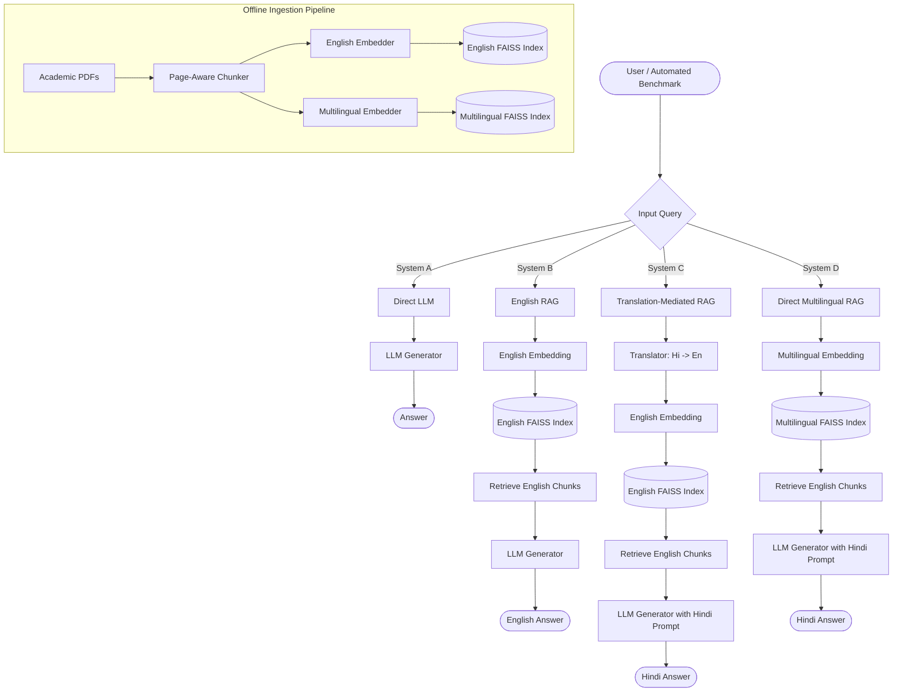

# Product Requirements Document (PRD) & High-Level Design
**Project Name:** English-Hindi Cross-Lingual Academic RAG Experimentation Platform
**Version:** 2.0
**Document Status:** Finalized for Implementation

## 1. Overview and Objective
This project is a dedicated research experimentation platform, not a production end-user chatbot. Its primary objective is to investigate how different methods of bridging the Hindi-English language gap affect Retrieval-Augmented Generation (RAG) performance in an academic context. 

**Core Research Question:** When an academic question is asked in Hindi but the knowledge base is primarily in English, how does the method used to bridge the language gap affect retrieval quality, answer correctness, faithfulness, and computational cost?

## 2. High-Level Design (HLD) & Architecture

The system is designed around a modular pipeline architecture that allows for strict A/B/C/D testing. The following diagram illustrates the High-Level Design and data flow for the four distinct experimental pipelines.



## 3. System Architecture & The Four Pipelines
The architecture is designed to enforce strict experimental controls. The primary comparison is between C (Translation) and D (Multilingual Embedding).

| ID | System | Input Language | Architecture / Pipeline Flow | Final Output |
| :--- | :--- | :--- | :--- | :--- |
| **A** | Direct LLM Baseline | Any | Question &rarr; LLM (No Retrieval) | Answer |
| **B** | English RAG | English | English Question &rarr; English FAISS Index &rarr; English Corpus Chunks &rarr; LLM | English Answer |
| **C** | Translation-mediated RAG | Hindi | Hindi Question &rarr; **Translate to English** &rarr; English FAISS Index &rarr; English Corpus Chunks &rarr; LLM &rarr; **Translate/Generate in Hindi** | Hindi Answer |
| **D** | Direct Multilingual RAG | Hindi | Hindi Question &rarr; **Multilingual FAISS Index** (Zero-shot cross-lingual) &rarr; English Corpus Chunks &rarr; LLM | Hindi Answer |

## 4. Technology Stack, Dependencies & APIs

### 4.1 Required External APIs
*   **Generation (LLM) API:** OpenAI API (e.g., `gpt-4o-mini` or `gpt-3.5-turbo`) or a local equivalent served via vLLM/Ollama. *Constraint:* Must be documented and temperature strictly set to `0`.
*   **Translation API (For System C):** Google Cloud Translation API, DeepL API, or a robust free tier alternative like `deep-translator` (Google Translate web endpoint).
*   **Model Hub API:** HuggingFace Hub (for downloading embedding models).

### 4.2 Required Python Libraries (`requirements.txt`)
*   **Orchestration & RAG:** `langchain`, `langchain-core`, `langchain-community`
*   **LLM Providers:** `langchain-openai` (if using OpenAI), or `langchain-huggingface`
*   **Vector Store:** `faiss-cpu` (or `faiss-gpu` if hardware allows)
*   **Embeddings:** `sentence-transformers`, `torch`
*   **Document Parsing:** `pypdf` (critical for maintaining page boundaries)
*   **Translation:** `deep-translator` or `google-cloud-translate`
*   **UI (Minimal):** `streamlit`
*   **Data Handling & Config:** `pandas`, `pyyaml`, `uuid`

## 5. Component Specifications

### 5.1 Data Ingestion & Processing
*   **Corpus:** 15-20 public/licensed academic PDFs (Algorithms, Automata, DBMS, Operating Systems, Computer Networks).
*   **Processing Rules:** Extract text preserving page boundaries. Clean artifacts without altering semantic meaning. Assign stable chunk IDs (e.g., `doc1_page4_chunk2`).
*   **Chunking:** Configurable. Initial target: 500-800 tokens, 50-100 token overlap.

### 5.2 Embedding & Vector Store
*   **English Index (Systems B & C):** Requires an English model (e.g., `sentence-transformers/all-mpnet-base-v2`).
*   **Multilingual Index (System D):** Requires a cross-lingual model (e.g., `sentence-transformers/paraphrase-multilingual-MiniLM-L12-v2`).
*   **Constraint:** Both indexes operate on the *exact same underlying chunked English text*.

## 6. Observability & Logging Schema
Strict observability is mandatory. Silent fails are prohibited.

| Field | Description/Purpose |
| :--- | :--- |
| `run_id` | Unique UUID for the execution. |
| `timestamp` | UTC execution time. |
| `question_id` | Foreign key linking to the Benchmark CSV. |
| `system_id` | A, B, C, or D. |
| `original_question` | The exact user input. |
| `translated_question` | English translation (System C only). |
| `retrieved_chunks` | Ordered array of retrieved stable chunk IDs. |
| `retrieval_scores` | Array of distances/scores from FAISS. |
| `source_documents` | Metadata (Page, Doc ID) for retrieved chunks. |
| `generated_answer` | Exact final answer text. |
| `intermediate_answer_en` | Useful for tracking System C's multi-step generation. |
| `latencies` | Tracking in ms: `retrieval_latency_ms`, `translation_latency_ms`, `generation_latency_ms`, `total_latency_ms`. |
| `error_status` | Success or Failure. |

## 7. Evaluation Framework

### 7.1 Benchmark Dataset Schema (`questions.csv`)
~120 paired questions. Schema: `question_id`, `subject`, `category`, `question_en`, `question_hi`, `gold_answer`, `answerable`, `gold_document_id`, `gold_page`, `gold_chunk_id`.

### 7.2 Error Taxonomy
*   **E1 - Translation drift:** Translation changes/loses the intended technical meaning (System C).
*   **E2 - Retrieval failure:** Relevant chunk is absent or ranked too low.
*   **E3 - Generation failure:** Evidence is present, but LLM hallucinates or misses facts.
*   **E4 - Language failure:** Substance is correct, but Hindi phrasing/terminology is poor.

## 8. Project Directory Structure
```text
cross_lingual_rag/
├── app.py                     # Minimal Streamlit UI for manual testing
├── config.yaml                # Frozen experiment configuration
├── requirements.txt           # Python dependencies
├── README.md                  # Setup and execution instructions
├── data/
│   ├── corpus/                # Raw PDF files
│   ├── indexes/               # Saved FAISS index files
│   │   ├── english/
│   │   └── multilingual/
│   └── benchmark/             # questions.csv
├── src/
│   ├── ingestion.py           # Document loading and parsing
│   ├── chunking.py            # Page-aware text splitting
│   ├── embeddings.py          # Model initialization
│   ├── vector_store.py        # FAISS abstraction
│   ├── translation.py         # Translation API wrappers
│   ├── generation.py          # LLM invocation and fixed prompts
│   ├── retrieval.py           # Search logic
│   ├── pipelines.py           # Core A/B/C/D orchestration
│   ├── evaluation.py          # Recall@k, MRR calculation scripts
│   ├── logging_utils.py       # JSON schema writers
│   └── utils.py               
├── prompts/
│   └── rag_prompt.txt         # Frozen prompt template
├── results/
│   ├── raw/                   # JSON logs per query
│   ├── csv/                   # Aggregated metrics
│   └── summaries/
└── tests/
    └── test_basic_pipeline.py # 10-question smoke test
```

## 9. Development Sequence & Experimental Controls
1. **Setup:** Set up repository, environment, and `config.yaml`.
2. **Ingestion:** Implement PDF ingestion and page-aware chunking.
3. **Indexing:** Implement English and multilingual embeddings + FAISS.
4. **Interfaces:** Implement generic retrieval, generation, and translation interfaces.
5. **Orchestration:** Implement A/B/C/D pipelines in `pipelines.py`.
6. **Observability:** Implement complete JSON logging.
7. **Smoke Test:** Run a 10-question test to verify no silent errors.
8. **Benchmark:** Finalize the 120-question paired dataset.
9. **Execution:** Freeze configuration and run automated pipeline execution over the benchmark dataset.
10. **Analysis:** Run `evaluation.py` to calculate Recall@1/3/5, MRR, latency, and E1-E4 errors.

### 9.1 Experimental Controls (Strict Mandates)
*   Same corpus for B, C and D.
*   Same underlying paired English/Hindi information needs.
*   Same top-k in the main experiment.
*   Same generation model/settings (temperature = 0).
*   Same chunking/index construction parameters.
*   No manual editing of answers.
*   No prompt changes per question during the main run.

## 10. Pseudocode Specifications

### 10.1 System C (Translation-Mediated RAG) Logic
```text
FUNCTION execute_system_C(hindi_question, config):
    logger = start_timer()
    
    // 1. Translate
    start_trans = get_time()
    english_query = api_translate(hindi_question, from="hi", to="en")
    logger.record("translation_latency_ms", get_time() - start_trans)
    logger.record("translated_question", english_query)
    
    // 2. Retrieve (Using English Query on English Index)
    start_ret = get_time()
    faiss_eng = load_vector_store("english")
    retrieved_docs, scores = faiss_eng.search(english_query, k=config.top_k)
    logger.record("retrieval_latency_ms", get_time() - start_ret)
    logger.record_chunks(retrieved_docs)
    
    // 3. Generate (Prompt dictates Hindi output based on English context)
    start_gen = get_time()
    context = format_context(retrieved_docs)
    hindi_answer = llm.generate(prompt=rag_prompt_hindi, context=context, question=english_query)
    logger.record("generation_latency_ms", get_time() - start_gen)
    
    return logger.save_and_return(hindi_answer)
```

### 10.2 System D (Direct Multilingual RAG) Logic
```text
FUNCTION execute_system_D(hindi_question, config):
    logger = start_timer()
    
    // 1. Retrieve (Directly using Hindi Query on Multilingual Index)
    // No translation step!
    start_ret = get_time()
    faiss_multi = load_vector_store("multilingual")
    retrieved_docs, scores = faiss_multi.search(hindi_question, k=config.top_k)
    logger.record("retrieval_latency_ms", get_time() - start_ret)
    logger.record_chunks(retrieved_docs)
    
    // 2. Generate (Prompt dictates Hindi output based on English context)
    start_gen = get_time()
    context = format_context(retrieved_docs)
    hindi_answer = llm.generate(prompt=rag_prompt_hindi, context=context, question=hindi_question)
    logger.record("generation_latency_ms", get_time() - start_gen)
    
    return logger.save_and_return(hindi_answer)
```